# Clean Architecture — Example: ProductConfigViewModel

`ProductConfigViewModel` is the most complex ViewModel in the app. It touches every
architecture layer, making it a complete example of how the layers interact.

## Layer map

```
┌─────────────────────────────────────────────────────────────────┐
│  PRESENTATION  ProductConfigScreen                              │
│                      │ uses                                     │
│                ProductConfigViewModel                           │
│                ProductConfigUiState / Action / Event            │
└──────────────────────┼──────────────────────────────────────────┘
                       │ calls (inject via Koin)
┌──────────────────────▼──────────────────────────────────────────┐
│  DOMAIN        Use Cases (one class = one operation)            │
│                GenerateModelUseCase                             │
│                SubmitProstheticOrderUseCase                     │
│                SaveOrderLocallyUseCase                          │
│                SaveInsoleOrderLocallyUseCase                    │
│                UploadTextureImageUseCase                        │
│                UploadReferencePhotoUseCase                      │
│                MeasurementValidator                             │
│                      │                                          │
│                Repository Interfaces (contracts only)           │
│                ProductRepository  OrderRepository               │
│                Model3DRepository  StorageRepository             │
│                      │                                          │
│                Domain Models                                    │
│                ProductConfig  InsoleOrderConfig                 │
│                ProstheticCoverOrderConfig  PricingEngine        │
└──────────────────────┼──────────────────────────────────────────┘
                       │ implemented by
┌──────────────────────▼──────────────────────────────────────────┐
│  DATA          ProductRepositoryImpl  OrderRepositoryImpl       │
│                Model3DRepositoryImpl  StorageRepositoryImpl     │
│                      │                │                         │
│                Ktor API Services   SQLDelight queries           │
│                ProductApiService   InsoleOrderConfigQueries     │
│                OrderApiService     AdaptedModel3DQueries        │
│                Model3DApiService   ProductConfigQueries         │
└─────────────────────────────────────────────────────────────────┘
```

## Class diagram

```mermaid
classDiagram
    %% ── PRESENTATION ─────────────────────────────────────────────────────────────

    class ProductConfigScreen {
        <<Composable>>
        +viewModel ProductConfigViewModel
    }

    class ProductConfigViewModel {
        -productRepo ProductRepository
        -generateModel GenerateModelUseCase
        -submitProstheticOrder SubmitProstheticOrderUseCase
        -uploadTextureImage UploadTextureImageUseCase
        -uploadUserImage UploadReferencePhotoUseCase
        -validator MeasurementValidator
        -saveOrderLocally SaveOrderLocallyUseCase
        -saveInsoleOrderLocally SaveInsoleOrderLocallyUseCase
        -orderRepo OrderRepository
        +uiState StateFlow~ProductConfigUiState~
        +events SharedFlow~ProductConfigUiEvent~
        +onAction(ProductConfigAction)
    }

    class ProductConfigUiState {
        +selectedProduct Product
        +currentConfig ProductConfig
        +orderType OrderType
        +insoleConfig InsoleOrderUiState
        +prostheticConfig ProstheticOrderUiState
        +priceEstimate PriceEstimate
        +isLoading Boolean
        +isSaving Boolean
        +uploadProgress Int
        +error String
    }

    class ProductConfigUiEvent {
        <<sealed>>
        NavigateToPreview(taskId, configId)
        NavigateToOrderSummary(configId)
    }

    class ProductConfigAction {
        <<sealed>>
        Enter(ConfigEntryMode)
        SaveAndProceed
        SubmitInsoleOrder
        SubmitProstheticOrder
        UpdateMaterial · UpdateColor · UpdateTexture
        UpdateMeasurement · UpdateQuantity
        UpdateInsolePrimaryFoot · UpdateInsoleSecondFoot
        UpdateProstheticSide · SelectLimbLevel
        SelectProstheticSubtype · UpdateProstheticMaterial
        RequestPriceUpdate · ClearError
    }

    class ConfigEntryMode {
        <<sealed>>
        DirectNew(preselect OrderType)
        FromProduct(productId)
        FromExistingConfig(configId)
    }

    class InsoleOrderUiState {
        +primaryFoot InsoleFootConfig
        +secondFoot InsoleFootConfig
        +material Material
        +color ProductColor
        +quantity Int
    }

    class ProstheticOrderUiState {
        +limbSide LegSide
        +limbLevel LimbLevel
        +prostheticType ProstheticType
        +commonMeasurements ProstheticCommonMeasurements
        +suspensionType SuspensionType
        +material Material
        +texture Texture
        +quantity Int
    }

    class OrderType     { <<enumeration>> INSOLE · PROSTHETIC_COVER }
    class LimbLevel     { <<enumeration>> ABOVE_KNEE · BELOW_KNEE }
    class LegSide       { <<enumeration>> LEFT · RIGHT }

    %% ── DOMAIN · USE CASES ───────────────────────────────────────────────────────

    class GenerateModelUseCase {
        -repo Model3DRepository
        +invoke(ProductConfigDto) Resource~String~
    }
    class SubmitProstheticOrderUseCase {
        -repo OrderRepository
        +invoke(ProstheticCoverOrderConfig) Resource~String~
    }
    class SaveOrderLocallyUseCase {
        -repo OrderRepository
        +invoke(ProductConfig, PriceEstimate) Resource~Unit~
    }
    class SaveInsoleOrderLocallyUseCase {
        -repo OrderRepository
        +invoke(InsoleOrderConfig, PriceEstimate, basePrice) Resource~Unit~
    }
    class UploadTextureImageUseCase {
        -repo StorageRepository
        +invoke(uri, configId, userId) Flow~UploadState~
        +needsUpload(url) Boolean
    }
    class UploadReferencePhotoUseCase {
        -repo StorageRepository
        +invoke(uri, configId, userId) Flow~UploadState~
        +needsUpload(url) Boolean
    }
    class MeasurementValidator {
        +validate(Measurement, OrderCategory) String
        +validateInscription(String) String
        +validateQuantity(Int) String
    }

    %% ── DOMAIN · REPOSITORY INTERFACES ──────────────────────────────────────────

    class ProductRepository {
        <<interface>>
        +getProduct(id) Resource~Product~
        +getConfigById(id) ProductConfig
        +getConfigsForProduct(productId) List~ProductConfig~
        +saveConfig(ProductConfig)
    }
    class OrderRepository {
        <<interface>>
        +saveOrderLocally(ProductConfig, PriceEstimate) Resource~Unit~
        +saveInsoleOrderLocally(InsoleOrderConfig, PriceEstimate, base) Resource~Unit~
        +submitProstheticCoverOrder(ProstheticCoverOrderConfig) Resource~String~
        +linkOrderToAdaptedModel(configId, modelId) Resource~Unit~
    }
    class Model3DRepository {
        <<interface>>
        +submitGeneration(request) Resource~String~
    }
    class StorageRepository {
        <<interface>>
        +uploadImage(bytes, path) Resource~String~
    }

    %% ── DOMAIN · MODELS ──────────────────────────────────────────────────────────

    class ProductConfig {
        +id String
        +productId String
        +orderCategory OrderCategory
        +material Material
        +texture Texture
        +color ProductColor
        +measurement Measurement
        +inscription String
        +additionalElements List~AdditionalElement~
        +quantity Int
    }
    class InsoleOrderConfig {
        +orderId String
        +leftFoot InsoleFootConfig
        +rightFoot InsoleFootConfig
        +material Material
        +quantity Int
        +priceEstimate Double
    }
    class ProstheticCoverOrderConfig {
        +orderId String
        +prostheticType ProstheticType
        +suspensionType SuspensionType
        +material Material
        +texture Texture
        +commonMeasurements ProstheticCommonMeasurements
    }
    class PricingEngine {
        <<object>>
        +calculate(ProductConfig, base) PriceEstimate
        +calculateForInsole(InsoleOrderConfig, base) PriceEstimate
    }
    class PriceEstimate {
        +basePrice Double
        +total Double
        +currency String
    }
    class Material      { <<enumeration>> SILICONE · CARBON_FIBER · PLA · TPU }
    class Texture       { +id String · +name String · +previewUrl String }
    class Measurement   { +width Double · +height Double · +depth Double }
    class ProductColor  { +name String · +hex String }

    %% ── DATA LAYER (abbreviated) ─────────────────────────────────────────────────

    class ProductRepositoryImpl {
        <<data layer>>
        -api ProductApiService
        -db AppDatabase
    }
    class OrderRepositoryImpl {
        <<data layer>>
        -api OrderApiService
        -db AppDatabase
    }
    class Model3DRepositoryImpl {
        <<data layer>>
        -api Model3DApiService
        -db AppDatabase
    }
    class StorageRepositoryImpl {
        <<data layer>>
        -firebaseStorage FirebaseStorage
    }

    %% ── NAVIGATION TARGETS ───────────────────────────────────────────────────────

    class ModelPreviewScreen    { <<Composable>> }
    class OrderSummaryScreen    { <<Composable>> }

    %% ── RELATIONSHIPS ────────────────────────────────────────────────────────────

    %% Screen → ViewModel
    ProductConfigScreen --> ProductConfigViewModel

    %% ViewModel state/events/actions
    ProductConfigViewModel --> ProductConfigUiState
    ProductConfigViewModel --> ProductConfigUiEvent
    ProductConfigViewModel --> ProductConfigAction
    ProductConfigUiState --> InsoleOrderUiState
    ProductConfigUiState --> ProstheticOrderUiState
    ProductConfigUiState --> OrderType
    ProductConfigAction --> ConfigEntryMode
    InsoleOrderUiState --> Material
    ProstheticOrderUiState --> Material
    ProstheticOrderUiState --> Texture

    %% ViewModel → Use cases (domain boundary)
    ProductConfigViewModel --> GenerateModelUseCase
    ProductConfigViewModel --> SubmitProstheticOrderUseCase
    ProductConfigViewModel --> SaveOrderLocallyUseCase
    ProductConfigViewModel --> SaveInsoleOrderLocallyUseCase
    ProductConfigViewModel --> UploadTextureImageUseCase
    ProductConfigViewModel --> UploadReferencePhotoUseCase
    ProductConfigViewModel --> MeasurementValidator
    ProductConfigViewModel --> ProductRepository
    ProductConfigViewModel --> OrderRepository

    %% Use cases → Repository interfaces (domain boundary)
    GenerateModelUseCase --> Model3DRepository
    SubmitProstheticOrderUseCase --> OrderRepository
    SaveOrderLocallyUseCase --> OrderRepository
    SaveInsoleOrderLocallyUseCase --> OrderRepository
    UploadTextureImageUseCase --> StorageRepository
    UploadReferencePhotoUseCase --> StorageRepository

    %% Domain models
    ProductConfig --> Material
    ProductConfig --> Texture
    ProductConfig --> Measurement
    PricingEngine ..> PriceEstimate
    ProductConfigUiState --> ProductConfig
    ProductConfigUiState --> PriceEstimate

    %% Repository implementations (data layer)
    ProductRepositoryImpl ..|> ProductRepository
    OrderRepositoryImpl ..|> OrderRepository
    Model3DRepositoryImpl ..|> Model3DRepository
    StorageRepositoryImpl ..|> StorageRepository

    %% Navigation
    ProductConfigUiEvent ..> ModelPreviewScreen
    ProductConfigUiEvent ..> OrderSummaryScreen
```



## Key architecture rules demonstrated here

| Rule | Where you see it |
|---|---|
| ViewModel never imports Ktor, Room, SQLDelight | `ProductConfigViewModel` imports only domain packages |
| Use cases own the business operation | `SaveInsoleOrderLocallyUseCase` calculates price via `PricingEngine` before saving |
| Repositories are interfaces in domain | `OrderRepository` is in `domain/repo/`; impl is in `data/repoimpl/` |
| State is immutable data class | `ProductConfigUiState` is a `data class`; updated via `setState { copy(...) }` |
| Navigation via events, not callbacks | VM emits `NavigateToPreview(taskId)` — screen observes and calls navController |
| Two entry paths for same screen | `ConfigEntryMode` — `DirectNew` (insole/prosthetic), `FromProduct` (catalog), `FromExistingConfig` |
